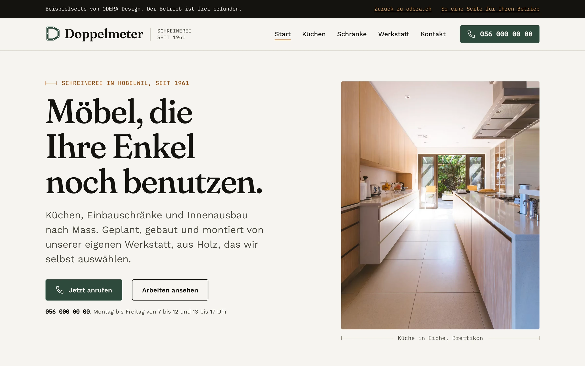
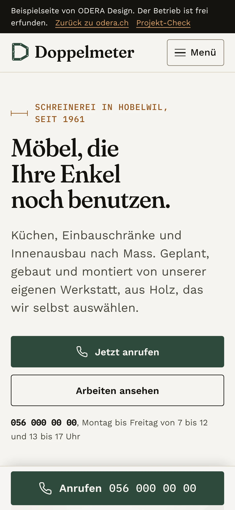
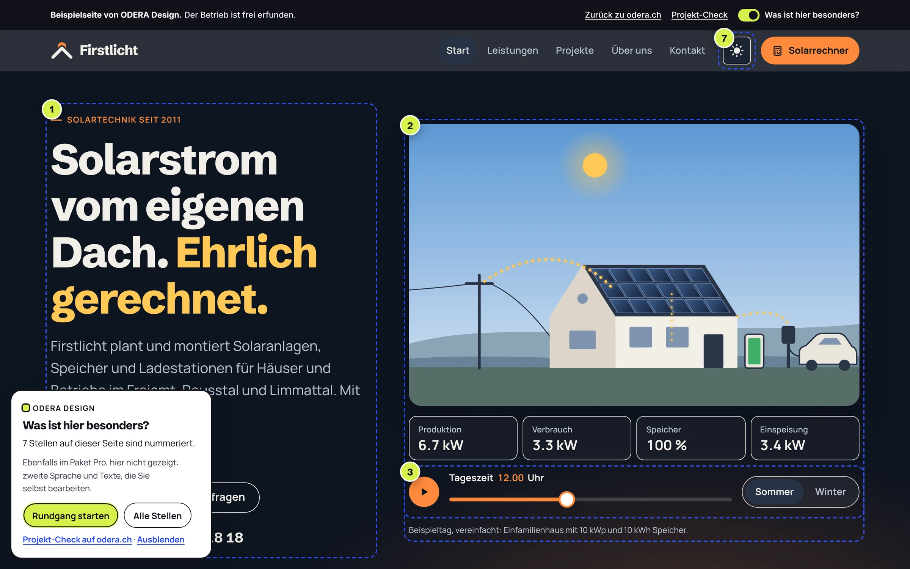
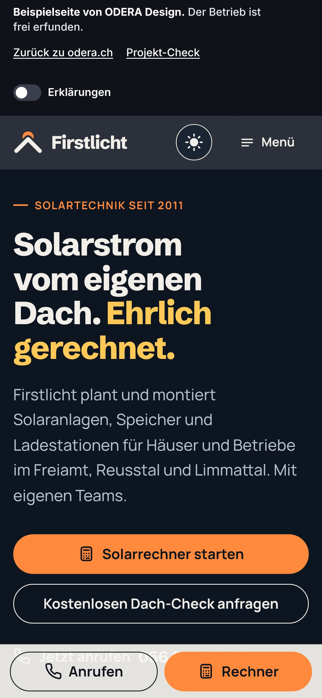

Damit Betriebe sehen, wie eine ODERA-Seite funktioniert, habe ich zwei frei erfundene Betriebe mit vollständigen Websites gebaut.

## Ausgangslage

Eine Beschreibung überzeugt einen Betrieb weniger als eine Seite, die er selbst bedienen kann. Echte Kundenprojekte zeige ich nicht. Also braucht es Beispiele, die vollständig sind und klar als erfunden gekennzeichnet.

## Ziel

Zwei Betriebe mit verschiedenen Zielen: Die Schreinerei will Anrufe, der Solarinstallateur vorbereitete Anfragen. Jede Seite soll zeigen, wie die Gestaltung diesem einen Ziel folgt, und keine Vorlage in anderen Farben sein.

## Schreinerei Doppelmeter

Paket Standard, 5 Seiten. Ziel der Seite ist der Anruf, darum steht die Telefonnummer auf jedem Bildschirm: oben rechts als Knopf und auf dem Handy in einer festen Leiste unten.

Die Gestaltung ist ruhig und handwerklich: warmes Papierweiss, eine Serifenschrift für die grossen Überschriften, Dunkelgrün für die Knöpfe und ein grosses Foto einer Küche mit Bildunterschrift. Kleine Zeilen wie «Schreinerei in Hobelwil, seit 1961» stehen in einer Schreibmaschinenschrift.

 

## Firstlicht Solartechnik

Paket Pro, 6 Seiten. Ziel ist die vorbereitete Anfrage: Ein Solarrechner rechnet vor, das Ergebnis wandert direkt ins Formular.

Der Auftritt ist dunkel mit Orange als Akzent und hat einen Umschalter für Hell und Dunkel. Im Hero steht ein Haus mit Solaranlage als Illustration. Mit einem Regler verschiebt man die Tageszeit und sieht Produktion, Verbrauch, Speicher und Einspeisung mitlaufen, wahlweise für Sommer oder Winter. Auf dem Handy bleiben «Anrufen» und «Rechner» unten erreichbar. Mit dem Schalter «Was ist hier besonders?» nummeriert die Seite sieben Stellen und erklärt sie.

 

## Entscheidungen

- **Frei erfunden und überall so gekennzeichnet.** Jede Seite trägt oben den Hinweis «Beispielseite von ODERA Design. Der Betrieb ist frei erfunden.»
- **Ein Ziel pro Seite.** Alles auf der Seite führt zum Anruf bzw. zur Anfrage.
- **Zwei eigenständige Auftritte.** Schrift, Farben und Bildsprache folgen dem Betrieb, nicht einer gemeinsamen Vorlage.
- **Messen statt behaupten.** Ladezeit und Lighthouse-Werte sind mit Methode und Datum festgehalten.

## Ergebnis

Zwei vollständige Websites, die Betriebe auf odera.ch selbst ausprobieren können. Die Messwerte stehen unten mit Quelle und Datum.
